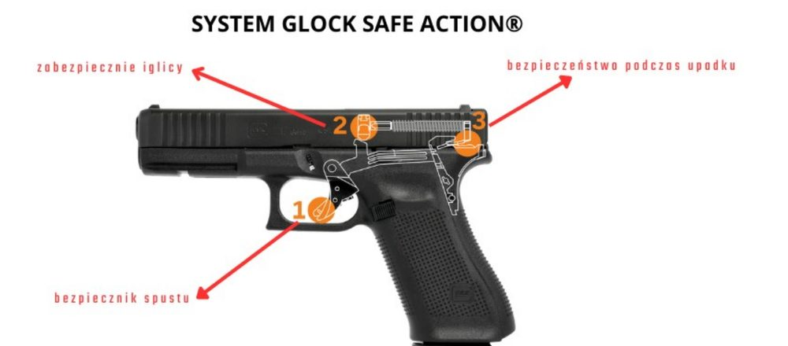
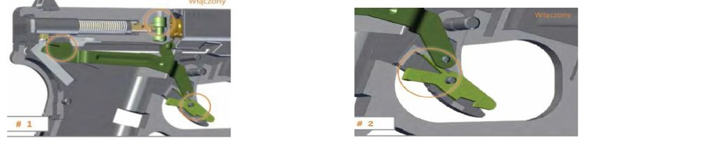
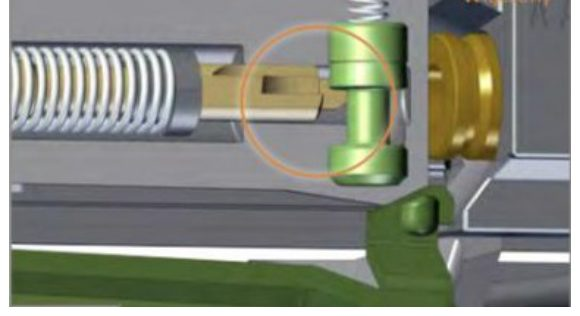
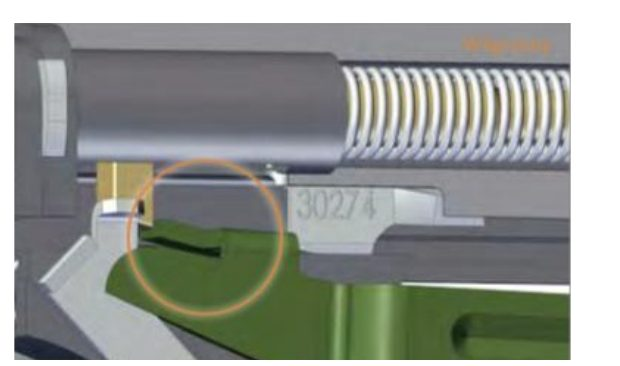
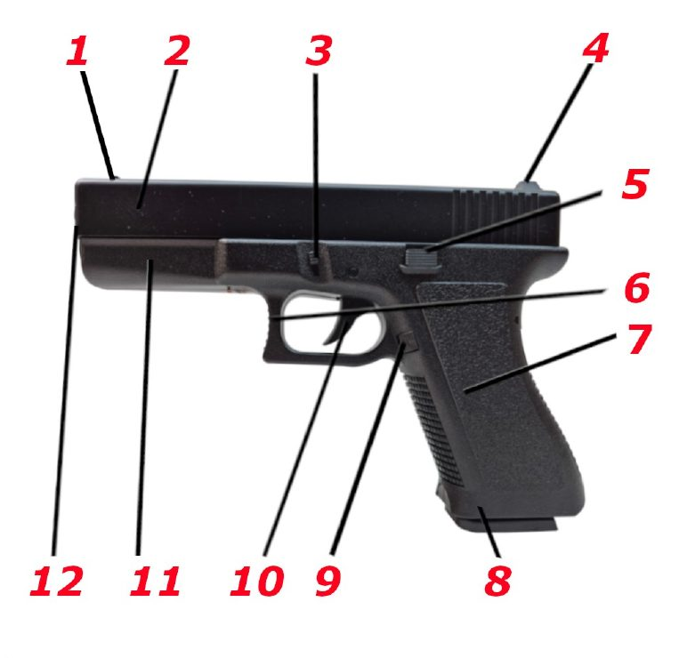
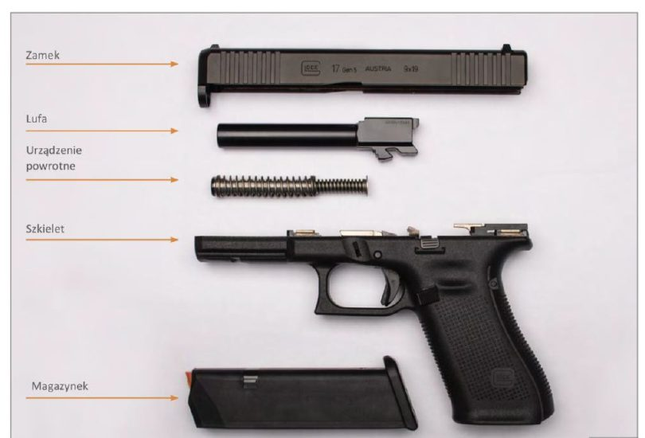
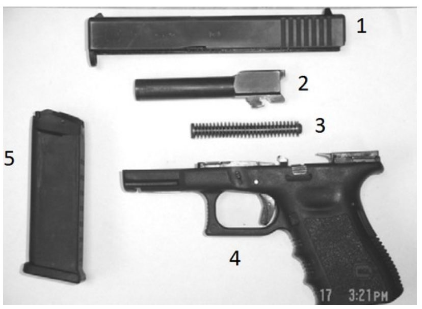
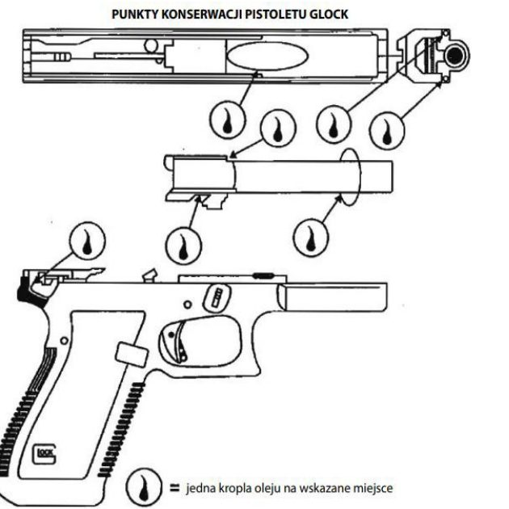

# Pistolet 9 mm GLOCK 17 gen. 5 MOS – instrukcja obsługi i użytkowania

Źródło: prezentacja „Instrukcja obsługi i użytkowania pistoletu 9 mm GLOCK 17 gen. 5 MOS” (materiały szkoleniowe SW). Tekst przepisany ze slajdów, rysunki ze slajdów.

## Zachowanie na strzelnicy – kolejność (notatki z zajęć)

1. **Podpisy** – regulamin strzelnicy, pokwitowanie odbioru amunicji.
2. Komenda **„Przygotować się!”**:
   - 1. magazynek – do ładownicy,
   - 2. magazynek – na stoliku,
   - sprawdzenie broni (skład, chwyt, postawa, zapracowanie na języku spustowym),
   - gdy gotowi – **broń do kabury, wolna ręka w górę**.
3. Komenda **„Ładuj broń!”** – dobywamy broń, podłączamy magazynek ze stolika, wrzucamy broń do kabury.
4. Komenda **„W cel – ognia!”** – dobywamy broń, przeładowujemy i prowadzimy ogień do tarczy **TS-9**.
   - Wymiana magazynka – samodzielnie; „awaria”.
5. **Po zakończonym strzelaniu** czekamy na komendę prowadzącego strzelanie: **„Przerwij ogień, rozładuj do przejrzenia broń”**.

## Przeznaczenie

- **Ogólnie** – pistolet przeznaczony jest do **samoobrony i walki na odległościach do 50 m**.
- **W Służbie Więziennej** wykorzystywany jest do takich czynności służbowych jak:
  - służba na stanowiskach uzbrojonych,
  - konwojowanie,
  - pościg,
  - wykonywanie innych obowiązków służbowych wymagających występowania z bronią krótką (strzelania programowe, szkolenia).

## Krótka charakterystyka

Pistolet jest **bronią automatyczną, samopowtarzalną**. Oznacza to, że wszystkie czynności związane z oddaniem kolejnego strzału wykonywane są automatycznie, a strzelać można **ogniem pojedynczym**.

Automatyka pistoletu działa na zasadzie **krótkiego odrzutu lufy**. Energia gazów prochowych powoduje wyrzucenie pocisku z lufy, a także, działając na dno łuski, odrzuca w tylne położenie zespół zamka z lufą. Po krótkim odcinku następuje rozłączenie zespołu (**odryglowanie lufy z komorą nabojową poprzez przekoszenie w płaszczyźnie pionowej**), dalej do tyłu przesuwa się tylko zamek, powodując przeładowanie pistoletu. Wracając, zamek pobiera z magazynka kolejny nabój, wsuwa go do komory nabojowej i **rygluje się powiększoną komorą nabojową w oknie wyrzutnika**.

Pistolet wyposażony jest w system **Safe Action** (z wyłączonym częściowym samonapinaniem iglicy). Oznacza to, że iglica po przeładowaniu **napięta jest jedynie częściowo**, a strzelec przez właściwe naciśnięcie języka spustowego (wciśnięcie bezpiecznika w języku spustowym) napina pozostałą część sprężyny iglicy, co ostatecznie kończy się zwolnieniem iglicy z zaczepu. W tym samym czasie **szyna spustowa unosi bezpiecznik iglicy**, co umożliwia iglicy uderzenie w spłonkę naboju i oddanie strzału.

## Dane taktyczno-techniczne

| Parametr | Wartość |
|---|---|
| Kaliber | **9 mm** |
| Amunicja | nabój pistoletowy **9×19 mm** |
| Prędkość początkowa pocisku | około **370 m/s** |
| Pojemność magazynka | **17 szt.** |
| Zabezpieczenie przed strzałem przypadkowym | wewnętrzna blokada iglicy |
| Ciężar bez magazynka | ok. **625 g** |
| Ustawienie przyrządów celowniczych | **25 m** |
| Profil lufy | **6 pól prawoskrętnych** |
| Opór spustu | **2,5 kg** |

## Urządzenia zabezpieczające – system Safe Action

Broń **nie posiada żadnych konwencjonalnych, rozmieszczonych na zewnątrz urządzeń zabezpieczających**, które trzeba oddzielnie odbezpieczać. Wszystkie urządzenia zabezpieczające i odbezpieczające działają **automatycznie**. Mechanizm spustowy **SAFE ACTION** (z wyłączonym częściowym samonapinaniem) obejmuje **trzy bezpieczniki automatyczne** i działa w sposób podobny do konwencjonalnego **DAO**.

### 1. Bezpiecznik spustu

Jest wbudowany w spust w postaci **środkowej wystającej dźwigni**. W przednim położeniu blokuje ona spust, uniemożliwiając jego ruch do tyłu. Żeby padł strzał, **bezpiecznik i spust muszą być świadomie ściągnięte jednocześnie**. Gdy broń zostanie upuszczona albo na spust działa nacisk z boku (poprzeczny), broń nadal nie może wystrzelić. Odbezpieczenie następuje tylko wtedy, gdy spust jest napinany **palcem spoczywającym na języku spustowym**. Takie rozwiązanie daje maksymalną gotowość do strzału w połączeniu z maksymalnym bezpieczeństwem użytkownika.

### 2. Blokada iglicy

Podparta **sprężyną** blokada iglicy stoi na drodze iglicy, zagradzając jej drogę naprzód. Po ściągnięciu spustu **występ szyny spustowej unosi blokadę**, odsłaniając drogę iglicy. W czasie odrzutu blokada, już niepodparta spustem, opada pod wpływem sprężyny. Blokada iglicy zapobiega przypadkowym wystrzałom **na skutek bezwładności** lub gdyby **ekstremalna siła zerwała zamek ze szkieletu**.

### 3. Bezpiecznik zaczepu spustowego

Rozszerzony **w formie krzyża** tylny koniec szyny spustowej stanowi integralny zaczep spustowy. Oba ramiona zaczepu spoczywają na specjalnie ukształtowanych **półkach tylnej wkładki**, stanowiących bezpiecznik zaczepu spustowego. Ściągnięcie spustu spycha ramiona z półki do zagłębienia, w którym **łącznik** ściąga w dół zaczep do punktu, w którym oddziela się on od **brody iglicy**. W czasie odrzutu **krzywka zamka wciska łącznik**, uwalniając zaczep spustowy, który wraca do pozycji wyjściowej pod wpływem sprężyny zaczepu spustowego, przechwytuje brodę iglicy, a jego ramiona wracają na półkę bezpiecznika zaczepu do czasu kolejnego ściągnięcia spustu.

## Ogólna budowa pistoletu GLOCK 17

1. Muszka
2. Zamek
3. Zaczep do rozkładania
4. Celownik
5. Dźwignia zatrzymania zamka (obustronna)
6. Kabłąk
7. Chwyt
8. Magazynek
9. Zatrzask magazynka
10. Spust
11. Szyna montażowa
12. Wylot lufy

## Częściowe rozłożenie pistoletu

1. Skieruj broń w **bezpiecznym kierunku**.
2. Trzymając **palec poza kabłąkiem**, naciśnij zatrzask magazynka i **odłącz magazynek**.
3. Chwytem nakładkowym ujmij zamek w tylnej części (tak, by nie zasłaniać okna wyrzutowego) i odciągnij zamek maksymalnie do tyłu, żeby sprawdzić, czy w komorze nabojowej nie ma naboju. **Dla pewności ten krok można powtórzyć.**
4. Odciągnij zamek i, unosząc kciukiem **dźwignię zatrzymania zamka**, zatrzymaj zamek w tylnym położeniu.
5. Sprawdź **wzrokowo** wlot komory nabojowej, gniazdo magazynka oraz tylną ściankę komory nabojowej (otwór iglicy), by upewnić się, że nie zostały tam żadne naboje.
6. Sprawdź **dotykiem** komorę nabojową lufy i gniazdo magazynka. W tym czasie zaleca się utrzymywać nacisk kciukiem na dźwignię zatrzymania zamka, żeby wykluczyć przypadkowe zwolnienie zamka.
7. Po sprawdzeniu zwolnij zamek, skieruj broń w bezpiecznym kierunku i, naciskając język spustowy, oddaj **strzał kontrolny**.
8. Jeżeli nie ma pewności co do stanu broni – **powtórz procedurę rozładowania i sprawdzenia bezpieczeństwa**.
9. Po sprawdzeniu (zakończonym strzałem kontrolnym) **spust powinien pozostać ściągnięty**, a iglica odłączona od szyny spustowej.
10. Przystępując do rozkładania, chwyć zamek w tylnej części nachwytem i **odciągnij go o 3 mm** – to odciąży zaczep do rozkładania i pozwoli ściągnąć go w dół.
11. Zaczep ściągaj **obustronnie i maksymalnie w dół**, po czym zsuń zamek do przodu ze szkieletu.
12. **Uwaga!** Odciągnięcie zamka dalej niż 3 mm spowoduje **reset spustu** (przechwycenie iglicy przez szynę spustową). Wtedy rozłożenie broni nie będzie możliwe bez ponownego ściągnięcia spustu, żeby zwolnić iglicę.

### Odłączenie urządzenia powrotnego i lufy

- Kciukiem i palcem wskazującym ujmij oba końce urządzenia powrotnego, wyciskając tylny (od strony komory nabojowej) w kierunku pierścienia zamka. Urządzenie powrotne jest wstępnie napięte, więc ugięcie go o **6 mm** pozwoli je odłączyć.
- Żeby odłączyć lufę, ujmij ją za wystającą brodę, delikatnie przesuń do przodu i unieś do góry, wysuwając w tył zamka.
- **Uwaga!** Przy rozkładaniu nie dopuść do upadku zamka – grozi to uszkodzeniem pierścienia zamka lub tylnych wlotów prowadnic.
- Żeby złożyć broń, dołącz elementy **w odwrotnej kolejności** i sprawdź współdziałanie elementów.

## Broń częściowo rozłożona

1. Zamek
2. Lufa
3. Urządzenie powrotne
4. Szkielet
5. Magazynek

## Przyrządy celownicze

Pistolet wyposażony jest w **trytowe przyrządy celownicze**. Zawierają radioaktywny tryt, który emituje naładowane cząstki wchodzące w interakcję z wewnętrzną powłoką fosforu – wywołuje to radioluminescencję i fosforescencję, które strzelec widzi jako **świecący punkt**.

### Celowanie i oddanie celnego strzału – trzy etapy

1. **Zgranie przyrządów celowniczych.**
2. **Kontrola oddechu.**
3. **Praca na języku spustowym.**

Zgranie przyrządów celowniczych polega na ustawieniu na jednej linii: **oka strzelca, przyrządów celowniczych i celu**, znajdujących się po tej samej stronie osi ciała co ręka dominująca. Drugie oko (po stronie ręki wspierającej) powinno być **otwarte**, żeby nie zawężać pola widzenia. **Wzrok należy skupiać na muszce.**

## Praca na języku spustowym

Pistolet załadowany oznacza: nabój w komorze nabojowej, iglica częściowo napięta i zabezpieczona, spust w położeniu przednim. Bezpiecznik spustu (integralna część spustu) jest odbezpieczany palcem spoczywającym na spuście, co umożliwia pełne pociągnięcie spustu.

- Spust ma **ruch jałowy około 5 mm**. Gdy naciągnięcie spustu osiągnie 5 mm (**pierwszy opór**), broń jest odbezpieczona – iglica jest napinana.
- Gdy spust jest dalej pociągany do tyłu, szyna spustu zwalnia iglicę za pomocą **łącznika**.
- Nacisk na spust to około **2,5 kg**.

Praca na języku spustowym to prawidłowe ułożenie palca na języku oraz jego **płynny i równomierny nacisk (wybieranie) w linii prostej w tył**, tak by nie zmieniać położenia broni i lufy. Spust naciska się **środkową częścią pierwszego paliczka palca wskazującego**.

## Punkty konserwacji pistoletu GLOCK

## Zacięcia podczas strzelań

| Zacięcie – objawy | Przyczyna | Sposób usunięcia |
|---|---|---|
| **Niewprowadzenie naboju do komory nabojowej** – strzelający naciska spust, nie można oddać strzału; język spustowy jest „miękki”; zamek nie doszedł do skrajnego przedniego położenia, komora jest niezaryglowana. | złe przeładowanie pistoletu; zanieczyszczone części (komora nabojowa, prowadnice szkieletu) | dosłać zamek do przodu uderzeniem dłoni (palec zdjąć ze spustu) albo przeładować i strzelać dalej; oczyścić pistolet |
| **Niewypał** – po prawidłowym przeładowaniu (nabój w komorze) iglica zostaje zwolniona, ale strzał nie pada. | niesprawna amunicja (np. spłonka); niesprawny mechanizm spustowo-uderzeniowy | przeładować i strzelać dalej; oddać pistolet do naprawy |
| **Zakleszczenie łuski przez zamek** – łuska nie została wyrzucona i zakleszczyła się między zamkiem a lufą. | zanieczyszczone ruchome części; niesprawny wyrzutnik | przeładować, przechylając pistolet zakleszczoną łuską w dół, i strzelać dalej; przy niesprawnym wyrzutniku – do warsztatu |
| **Niedosłanie naboju** – przypomina niewypał, ale strzał nie pada, bo zamek nie pobrał naboju z magazynka. | źle dołączony (niedopchnięty) magazynek; uszkodzona sprężyna magazynka; zaklinowane naboje w magazynku | dobić magazynek, przeładować; wymienić magazynek |
| **Utykanie (ukosowanie) naboju** – spust „miękki”; zamek zatrzymał się w ruchu do przodu, bo nabój nie trafił do komory i, lekko ukosowany, oparł się o lufę. | uszkodzony magazynek (opór wylotu); źle załadowany magazynek | lekko odciągnąć zamek, żeby zluzować nabój, i z lufą skierowaną w dół naprowadzić nabój do komory; jeśli się nie uda – mocno odciągnąć zamek, usunąć nabój i wprowadzić kolejny; czasem trzeba odłączyć magazynek, usunąć nabój i dołączyć magazynek ponownie |
| **Niewyciągnięcie łuski z komory nabojowej** – spust „miękki”; zamek zatrzymał się w ruchu do przodu, bo w komorze została łuska. | zanieczyszczona komora nabojowa lub nabój; uszkodzony wyciąg | odłączyć magazynek (może być blokowany przez nabój), usunąć nabój, przeładowaniem spróbować usunąć łuskę (przy silnym zakleszczeniu wybić ją od strony lufy); oddać pistolet do warsztatu |
| **Zatrzymanie zamka w tylnym położeniu, choć w magazynku są naboje** – zamek zatrzymany przez dźwignię zatrzymania zamka. | zanieczyszczone części; przytrzymanie dźwigni zatrzymania zamka przez strzelającego; niesprawna sprężyna dźwigni | nacisnąć dźwignię zatrzymania zamka; przeczyścić pistolet; oddać pistolet do warsztatu |
